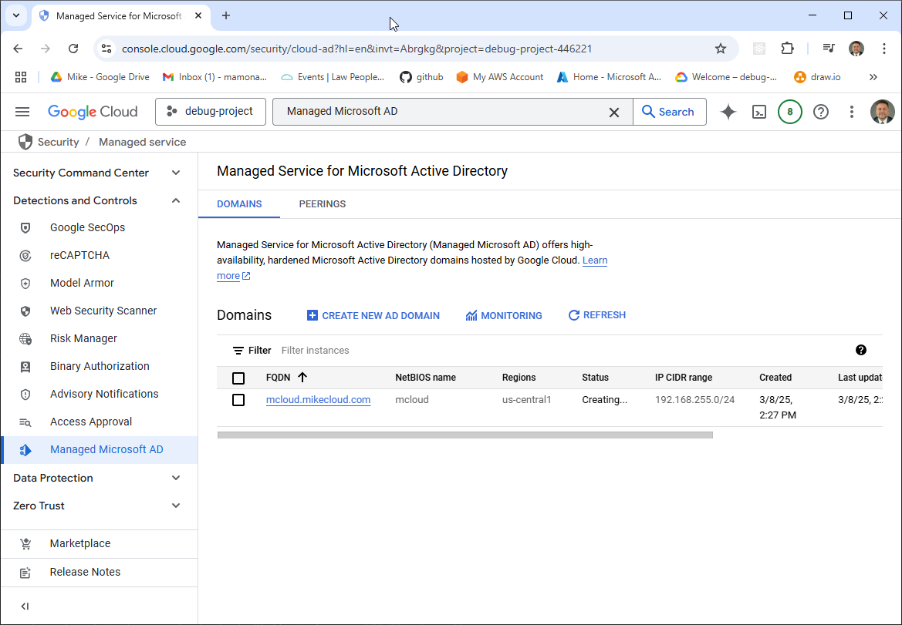
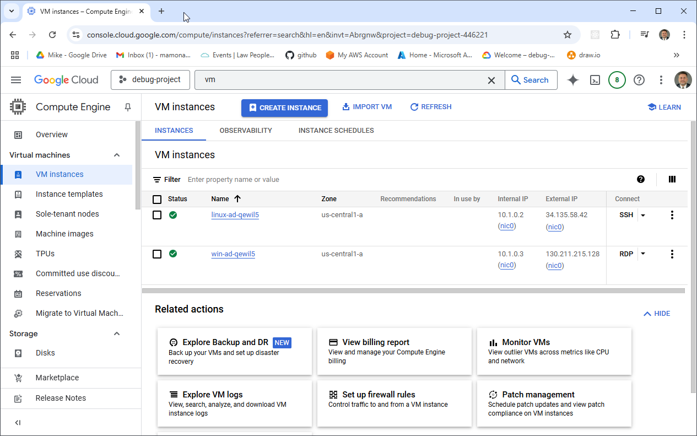
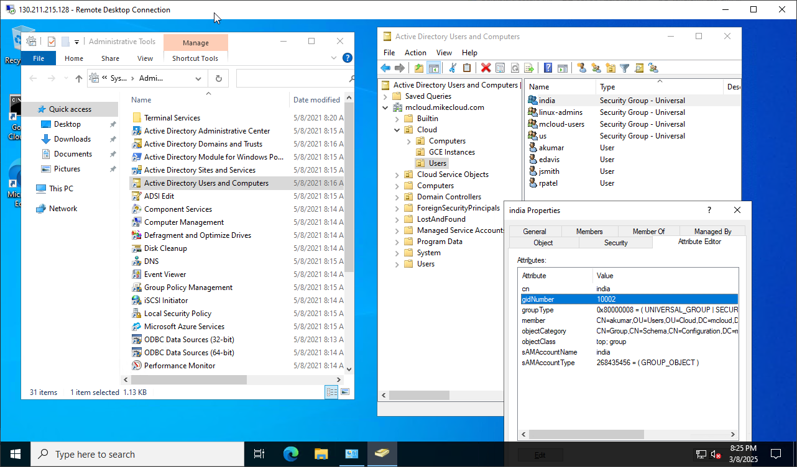

# Managed Microsoft AD on GCP

Part 3 of the series
[Deploying Active Directory in the Cloud](https://youtu.be/H5lKJPJBL5s).
Terraform builds Google's **Managed Service for Microsoft Active
Directory**, `apply.sh` resets its built-in admin's password into Secret
Manager, and a Linux and a Windows VM join the domain at boot. The Windows
VM also creates the lab's users and groups, with the POSIX attributes Linux
needs.

| Piece | Where | Role |
|---|---|---|
| **Managed Microsoft AD** | `us-central1`, reserved range 192.168.255.0/24 | domain `mcloud.mikecloud.com`; authorized for `managed-ad-vpc`; admin `MCLOUD\setupadmin` |
| **linux-ad VM** | `managed-ad-subnet` (10.1.0.0/24), public IP | Ubuntu 24.04, `e2-micro`; joins with `realm` and SSSD; SSH with AD passwords |
| **win-ad VM** | `managed-ad-subnet`, public IP | Windows Server 2022, `e2-standard-2`; joins the domain; installs RSAT; creates the AD groups and users |
| **Secret Manager** | global | `admin-ad-credentials-ad` and `<user>-ad-credentials-ad` |

## Architecture

<picture>
  <source media="(prefers-color-scheme: dark)" srcset="architecture-dark.svg">
  
</picture>

Regenerate with `python3 make_diagram.py`.

- **`01-directory/`**: the VPC (`managed-ad-vpc`) with its subnet, the managed domain, and the
  AD secrets in Secret Manager.
- **`02-servers/`**: the Linux and Windows VMs and their firewall rules.

## How the domain gets an admin

The managed domain comes with a `setupadmin` account. After phase 1,
`apply.sh` checks `admin-ad-credentials-ad`; if it's empty, it runs
`gcloud active-directory domains reset-admin-password` and stores
`MCLOUD\setupadmin` and the new password there. Re-runs keep the stored
password.

## How the members join

1. **Windows** (`ad_join.ps1`, a Windows startup script): skips itself if the
   VM is already joined; otherwise installs RSAT, reads the admin secret,
   and joins with `Add-Computer`. It then creates a `Users` OU under
   `OU=Cloud`, the groups, and, from each user's secret, the users, each with
   a `uidNumber` and `gidNumber`; adds `mcloud-users` to Remote Desktop
   Users; and reboots.
2. **Linux** (`ad_join.sh`, a startup script): reads the admin secret and
   joins with `realm join`. SSSD is set for short names and the POSIX IDs
   stored in AD; home directories are created on first login; `linux-admins`
   get passwordless sudo.

| User | Groups | uidNumber | sudo on Linux |
|---|---|---|---|
| jsmith | mcloud-users, us, linux-admins | 10001 | yes |
| edavis | mcloud-users, us | 10002 | no |
| rpatel | mcloud-users, india, linux-admins | 10003 | yes |
| akumar | mcloud-users, india | 10004 | no |

| Group | gidNumber |
|---|---|
| mcloud-users | 10001 |
| india | 10002 |
| us | 10003 |
| linux-admins | 10004 |

## Firewall rules

```
internet ─22──▶ linux-ad VM
internet ─3389─▶ win-ad VM
```

`ad-allow-ssh` and `ad-allow-rdp` allow `0.0.0.0/0`, by network tag; every
login still needs an AD account. The managed domain has no public address.

## Prerequisites

* [A Google Cloud Account](https://console.cloud.google.com/)
* [Install gcloud CLI](https://cloud.google.com/sdk/docs/install)
* [Install Terraform](https://developer.hashicorp.com/terraform/install)
* [Install jq](https://jqlang.github.io/jq/download/)

Put a service account key in the repository root as `credentials.json`;
`check_env.sh` activates it, and `api_setup.sh` enables the APIs the build
needs. If this is your first time watching our content, we recommend
starting with this video:
[GCP + Terraform: Easy Setup](https://youtu.be/3spJpYX4f7I).

## Deploy

```bash
git clone https://github.com/mamonaco1973/gcp-directory.git
cd gcp-directory
./apply.sh       # 1: VPC + Managed AD + secrets  (admin reset)  2: Linux and Windows VMs
```

Phase 1 takes **20–40 minutes**, almost all of it Google creating the
domain. After phase 2, the Windows VM needs several minutes to join, create
the users and reboot; the Linux VM can't resolve AD users until they exist.
`apply.sh` ends by running `validate.sh`:

```
============================================================================
Managed AD Quick Start - Validation Output (GCP)
============================================================================

NOTE: Windows RDP Host:      203.0.113.10
NOTE: Linux SSH Host:        203.0.113.20
```

## Try it

1. Get a user's password:

   ```bash
   gcloud secrets versions access latest --secret=rpatel-ad-credentials-ad \
     | jq -r .password
   ```

2. Look at the domain in the console under **Managed Microsoft AD**:

   

   

3. RDP to the **Windows RDP Host** as `MCLOUD\rpatel`. **Active Directory
   Users and Computers** shows the users and groups the VM created.

   

4. SSH to the **Linux SSH Host** as `rpatel`. Try `id`,
   `getent group linux-admins` and `sudo -l`.

   

## Troubleshooting

| Symptom | Fix |
|---|---|
| Phase 1 seems stuck | Creating the managed domain takes 20–40 minutes. |
| `id <user>` finds nothing on Linux | The Windows VM hasn't created the users yet. SSSD caches lookups; `sudo sss_cache -E` clears it. |
| SSH rejects every AD password | `sudo journalctl -u google-startup-scripts` on the Linux VM shows the join. |
| `jsmith` doesn't exist | See the known issue below. |

## Teardown

```bash
./destroy.sh     # destroys the VMs, then the managed domain, VPC and secrets
```

## Notes

- **Lab only.** SSH and RDP are open to the internet, both joins use the
  domain admin, and the VMs run as the same service account as Terraform
  with the `cloud-platform` scope. Restrict the firewall rules and use a
  dedicated join account for anything more.
- **Known issue:** Terraform names jsmith's secret `jsmith-ad-credential-ad`
  (no "s"), but `ad_join.ps1` reads `jsmith-ad-credentials-ad`, so the
  Windows VM can't create jsmith. The other three users are unaffected.
